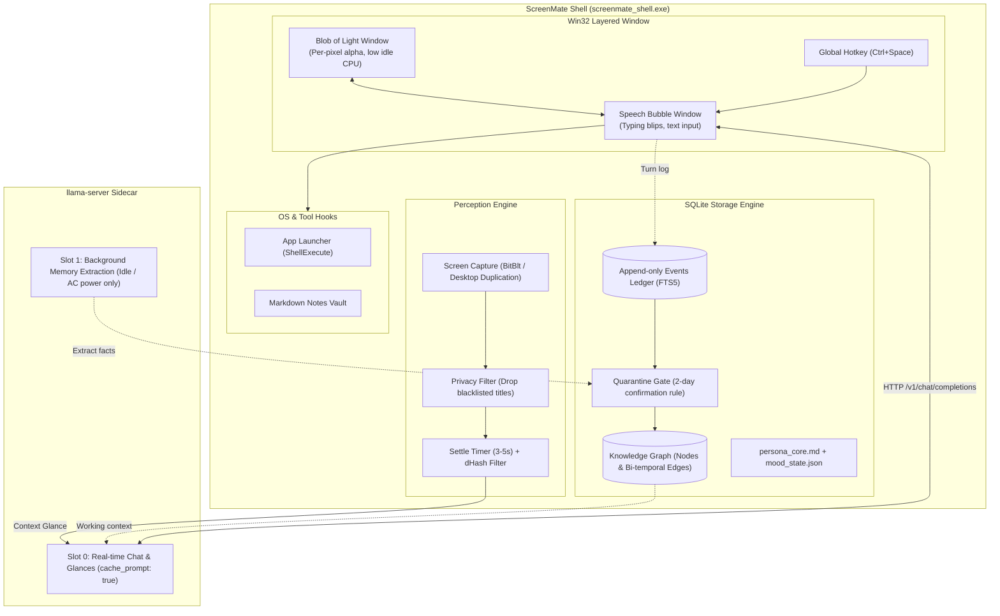

# ScreenMate AI

A lightweight, local-first Windows desktop companion written in C++20. It runs as a floating layered window on top of Windows, communicates with a local `llama-server` sidecar, observes desktop context with privacy filters, and maintains a decoupled knowledge graph in SQLite.

---

## Architecture

The system consists of two primary components:
1. `screenmate_shell`: A native Win32/C++20 process handling the desktop UI, screen perception, hotkey dispatch, and SQLite memory store.
2. `llama-server`: A local `llama.cpp` sidecar running a quantized multimodal model (e.g. Gemma 4 E4B Q4_K_M) across two isolated execution slots.



---

## Key Design Principles

- **Zero Cloud Dependency**: Runs 100% locally on consumer hardware (tested on an RTX 4060 Laptop GPU with 8GB VRAM).
- **Decoupled Memory ("The Soul")**: Memories and relationships are stored in SQLite (`data/soul.db`), not in the neural weights. Model checkpoints can be swapped without loss of memory.
- **Situational Mental Model**: Avoids naive chat-log concatenation. Maintains a compact situational state (<100 tokens) and relies on KV-cache continuity in slot 0 to achieve <500ms time-to-first-token.
- **Anchor Memories**: Core biographical facts (birthdays, allergies, personal lore) are flagged with `is_anchor = 1` and `decay_rate = 0.0`. They are immune to the Ebbinghaus forgetting curve.
- **2-Day Quarantine**: Speculative or single-observation inferences are quarantined and only promoted to the permanent graph if observed across multiple days.
- **Window Capture Exclusion**: Calls `SetWindowDisplayAffinity(WDA_EXCLUDEFROMCAPTURE)` on UI windows to prevent feedback loops during screen capture.

---

## Memory and Hardware Allocation (8GB RTX 4060)

| Component | VRAM Allocation | Notes |
| :--- | :--- | :--- |
| Model Weights (Gemma 4 E4B Q4_K_M) | ~3,360 MB | Full GPU layer offload (`-ngl 99`) |
| Multimodal Projector (`mmproj`) | ~512 MB | Vision encoder |
| KV Cache (`-np 2`, 8K total context) | ~512 MB | 4K tokens per slot |
| CUDA Driver / Runtime | ~288 MB | Host driver overhead |
| **Committed Total** | **~4,672 MB** | Leaves ~3.5 GB free for games and applications |

---

## Project Structure

```
├── CMakeLists.txt                  # CMake 3.20+ build file (C++20)
├── config/
│   └── model_profile.json          # llama-server parameters and slot assignments
├── data/
│   ├── persona_core.md             # Baseline companion persona definition
│   ├── mood_state.json             # Dynamic affinity and mood sliders
│   ├── voice_anchors.json          # Few-shot dialogue exemplars
│   └── soul_schema.sql             # SQLite schema DDL (events, nodes, edges, quarantine)
├── docs/
│   ├── ARCHITECTURE_AND_PLAN.md    # Initial system implementation plan
│   └── BRAIN_SPEC.md               # Complete 1,500-line memory and brain specification
├── include/
│   ├── brain/                      # C++20 brain interfaces (i_brain.h, i_soul_store.h, etc.)
│   ├── renderer/                   # BGRA pixel buffer and procedural blob renderer
│   └── ui/                         # Win32 UpdateLayeredWindow wrapper classes
├── src/
│   ├── main.cpp                    # Application entry point and Win32 message pump
│   ├── renderer/                   # Blob rendering implementation
│   └── ui/                         # Window creation, mouse dragging, and message handling
├── tests/                          # Automated test suites (schema, token budget, failure modes)
└── scripts/
    └── run_llama_server.bat        # Launch script for llama-server with dual slots
```

---

## Building and Running

### Prerequisites
- Windows 10/11 64-bit
- Clang (LLVM-MinGW) or MSVC with C++20 support
- CMake 3.20+ and MinGW Makefiles or Ninja

### Build Instructions

```powershell
# Configure
cmake -B build -G "MinGW Makefiles" -DCMAKE_BUILD_TYPE=Release

# Build the shell and test suite
cmake --build build --config Release

# Run tests
ctest --test-dir build --output-on-failure
pytest tests
```

### Running the Application

The compiled executable is located at:
```
build/screenmate_shell.exe
```

Run it directly from PowerShell or double-click `build/screenmate_shell.exe` in Windows Explorer:
```powershell
.\build\screenmate_shell.exe
```

Controls:
- **Left click**: Toggle speech bubble open or closed.
- **Left click and drag**: Move the blob across your desktop (open speech bubble follows).
- **Ctrl + Space (Global Hotkey)**: Open speech bubble from anywhere and focus text input.
- **Enter (in input field)**: Send prompt to local AI sidecar with streaming response.
- **Escape (in input field)**: Close speech bubble.
- **Double click on blob**: Cycle between emotional color states (Calm, Focused, Witty, Thinking, Alert).
- **Right click on blob**: Open context menu to cycle emotion or exit.

---

## Memory & Database Engine (Phase 3)

ScreenMate features a persistent SQLite memory store located at `data/soul.db` running in WAL mode:
- **Append-Only Event Ledger**: Every conversation turn is permanently preserved in the `events` table with automatic FTS5 full-text indexing.
- **Context Continuity**: The companion recalls recent dialogue turns and situational context across restarts.
- **Zero-Decay Anchors**: Permanent biographical facts (`is_anchor = 1`) are protected by database triggers with `decay_rate = 0.0`.
- **2-Day Quarantine Gate**: Prevents small local model hallucinations from corrupting the permanent knowledge graph.
