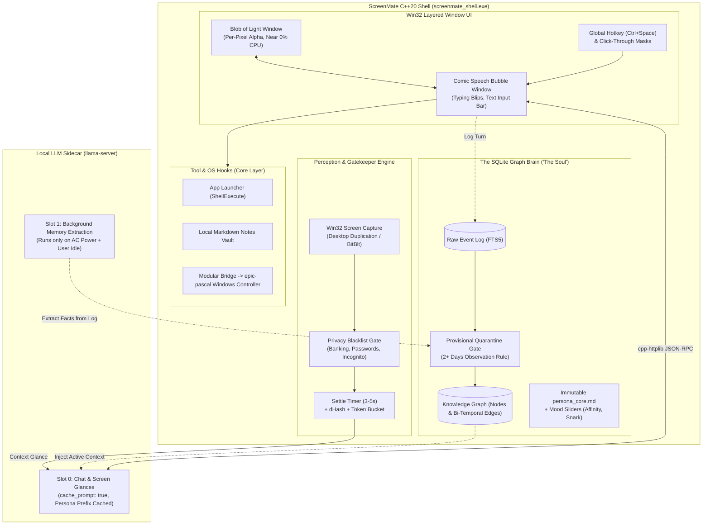

# ScreenMate AI: Living Desktop AI Companion

> An autonomous, visible, and evolving personal AI companion for Windows that lives on your screen as a reactive **"Blob of Light"**, perceives your desktop context, chats like a witty friend, and runs **100% locally and privately** on your GPU.

---

## 🌟 Overview & Product Vision

ScreenMate AI is designed as a genuine personal companion ("friend") rather than a sterile corporate assistant:
- **Visible Desktop Presence**: Sits on your screen as an organic, bioluminescent **Blob of Light** rendered to a native Win32 layered window (`UpdateLayeredWindow`) with near 0% CPU at idle.
- **100% Local Intelligence**: Runs a local multimodal model (such as **Gemma 4 E4B Q4_K_M** or **Qwen2-VL**) via a local `llama-server` sidecar. Consumes only ~4GB VRAM on an 8GB RTX 4060, leaving 4GB+ free for your games and daily applications.
- **Zero-Latency Two-Slot Architecture**: Uses `llama-server` with `-np 2`:
  - **Slot 0**: Dedicated to real-time chat and quick screen glances with `cache_prompt: true`. Prompt evaluation time is virtually **0ms** thanks to a byte-stable cached persona prefix.
  - **Slot 1**: Reserved for background memory extraction, running only when AC power is connected, user is idle, and GPU load is low.
- **The SQLite Graph Brain ("The Soul")**:
  - Completely **decoupled from model weights**: you can swap model weights at any time without losing memories, inside jokes, or your evolving friendship.
  - Raw append-only event log with SQLite **FTS5** full-text search.
  - Property knowledge graph (entities & bi-temporal edges).
  - **2-Day Provisional Quarantine**: Newly extracted facts are marked provisional and only promoted to long-term memory if observed across multiple separate days, stopping small-model hallucinations dead in their tracks.
- **Active Context Perception & Anti-Clippy Gatekeeper**:
  - Observes the active foreground window using low-overhead Win32 APIs with automatic capture exclusion (`WDA_EXCLUDEFROMCAPTURE`) so it never sees itself.
  - **Settle Timer (3–5s)** and **64-bit dHash filter** ensure it only processes stable screen state changes.
  - **Token Bucket** limits proactive remarks to once every 3–5 minutes (with auto-cooldown if ignored).
  - **Strict Privacy Gate**: Instantly drops and never captures password managers, banking, or incognito windows.
- **Instant Hotkey & Comic Dialogue**:
  - Press `Ctrl + Space` or click the blob to summon an expressive comic-book speech bubble with Undertale-style typing blips and a text input field.

---

## 🏗️ System Architecture



---

## 💻 Hardware Profile & VRAM Allocation

Tested for an **NVIDIA GeForce RTX 4060 Laptop GPU (8GB VRAM)**:

| Component | VRAM Footprint | Description |
| :--- | :--- | :--- |
| **Model Weights (Gemma 4 E4B Q4_K_M)** | ~4.2 GB | Multimodal vision & text model offloaded to GPU |
| **KV Cache (`-np 2`, 8K total context)** | ~0.6 GB | Split between Slot 0 (chat) and Slot 1 (extraction) |
| **CUDA Runtime & Driver** | ~0.3 GB | Base CUDA runtime overhead |
| **Free VRAM for User Games / Apps** | **~2.9 – 3.5 GB** | Stays responsive without forcing GPU OOM errors |

---

## 📁 Repository Layout

```
├── CMakeLists.txt                  # Modern CMake C++20 build configuration
├── .gitignore                      # Git ignore rules for builds, db, and binaries
├── README.md                       # Main project overview and documentation
├── docs/
│   └── ARCHITECTURE_AND_PLAN.md    # Detailed architectural design & milestone specs
├── config/
│   └── model_profile.json          # llama-server & model hyperparameters
├── data/
│   ├── persona_core.md             # Immutable witty friend persona definition
│   ├── voice_anchors.json          # Rolling few-shot conversation anchors
│   ├── mood_state.json             # Dynamic affinity, snark, and energy sliders
│   └── notes/                      # User local markdown notes vault
├── include/
│   ├── config.h                    # Configuration loader & constants
│   ├── renderer/                   # Procedural glowing blob & BGRA pixel buffer
│   ├── ui/                         # Win32 UpdateLayeredWindow wrappers
│   ├── perception/                 # Screen capture, dHash filter & privacy gate
│   ├── brain/                      # llama-server HTTP client & SQLite Graph Brain
│   └── tools/                      # App launcher and notes storage
├── src/                            # C++20 implementation sources
├── tests/                          # Unit and integration test suites
├── third_party/                    # Vendored single-header libraries (sqlite3, httplib, json, miniaudio)
└── scripts/
    └── run_llama_server.bat        # Convenience script to start llama-server with optimal flags
```

---

## 🚀 Getting Started

### Prerequisites
- **OS**: Windows 10 / 11 (64-bit)
- **Compiler**: Clang 18+ (LLVM-MinGW) or MSVC 2022+ with C++20 support
- **Build System**: CMake 3.20+ and Ninja / MinGW Makefiles
- **Inference Server**: `llama-server` (from llama.cpp CUDA releases)
- **Model**: `gemma-4-E4B-it-GGUF` (Q4_K_M) + matching multimodal projector (`mmproj`)

### Building from Source

```powershell
# Configure CMake
cmake -B build -G "MinGW Makefiles" -DCMAKE_BUILD_TYPE=Release

# Build executable and test suites
cmake --build build --config Release

# Run automated tests
ctest --test-dir build --output-on-failure
```

---

## 🗺️ Roadmap & Milestones

- [x] **Milestone 0: Architecture & Research**: Deep verification of llama-server flags, slot isolation, SQLite Graph Brain design, and VRAM budget.
- [ ] **Milestone 1: The Blob of Light & Layered Window**: Procedural bioluminescent particle & glow renderer running in a Win32 layered window at ~10 FPS idle.
- [ ] **Milestone 2: Hotkey & Local Chat**: `Ctrl + Space` comic bubble with typing blips connected to `llama-server` Slot 0.
- [ ] **Milestone 3: The SQLite Graph Brain**: FTS5 event log, knowledge graph, 2-day provisional quarantine, and persona evolution.
- [ ] **Milestone 4: Screen Perception**: Active window capture, settle timer, dHash change filter, and privacy blacklist.
- [ ] **Milestone 5: Foundational Tools & Extensibility**: App launcher, markdown notes vault, and bridging to the `epic-pascal` Windows UI automation controller.

